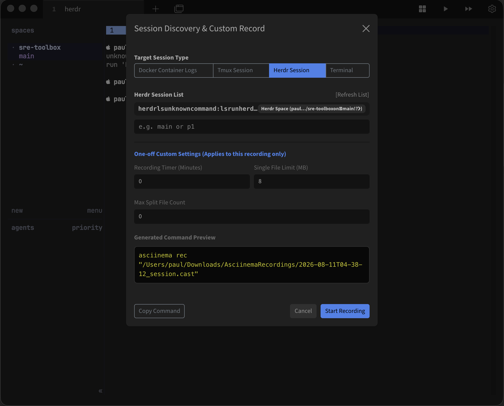
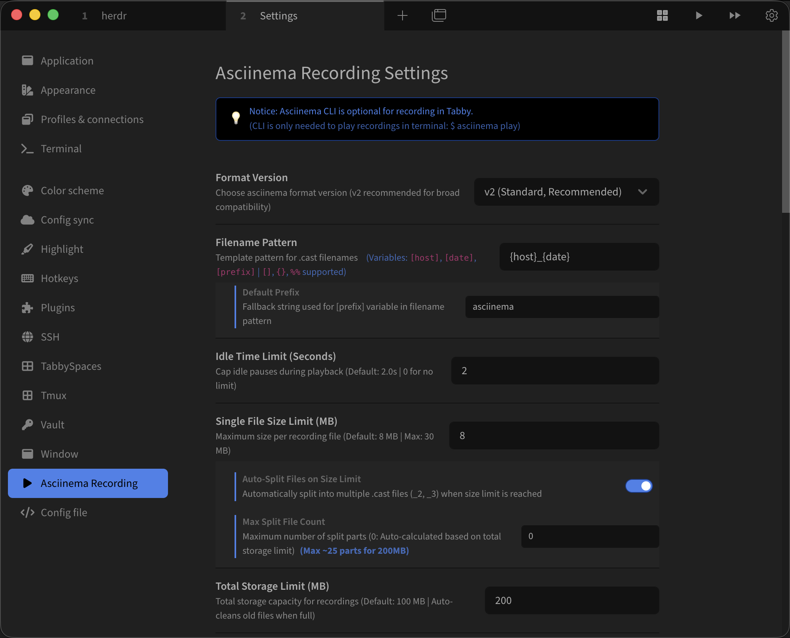

# Tabby Asciinema Helper Plugin

**Tabby Asciinema Helper** is a lightweight, native session recorder plugin for Tabby Terminal. Beyond standard terminal tabs, it empowers SREs, DevOps engineers, and developers to capture **Headless Target Sessions**—including **Herdr Multi-Agent Orchestrations**, **Background Docker Container Logs**, and **Detached Tmux Sessions**—into standard `.cast` format cleanly without external CLI requirements or shell screen clutter.

---

## Screenshots

  
  

---

## Key Highlights & Superpowers

* **Headless & Background Target Session Recording**: Seamlessly discover and attach to headless background processes, multi-agent panes (`herdr attach -t`), background containers (`docker logs -f`), and detached multiplexer sessions (`tmux attach -t`) without polluting your terminal screen.
* **Herdr Multi-Agent Orchestration Recording**: Capture complex multi-agent reasoning, tool invocations, and inter-agent workflows within Herdr Spaces and individual Agent Panes.
* **Pure Native Engine**: No local `asciinema` CLI binary required for recording. Uses Tabby's internal terminal output streams for direct `.cast` file generation.
* **Sensitive Data Masking**: Interactive scanning and redaction of IP addresses, API tokens, and passwords before sharing recordings.
* **Chronological File Sorting**: Default `{date}_{host}` filename pattern for clean file sorting, single file auto-splitting (8MB limit), and storage limit auto-cleanup.
* **Standalone HTML Web Player**: Generate self-contained HTML players to view `.cast` recordings in any web browser without CLI tools.

---

## 주요 강점 및 핵심 기능 (Korean Summary)

* **Headless & 백그라운드 대상 세션 녹화**: 화면에 직접 띄우지 않은 Headless 멀티에이전트, 백그라운드 Docker 컨테이너, 디태치된 Tmux 세션을 화면 오염 없이 선명하게 `.cast` 포맷으로 캡처.
* **Herdr 멀티에이전트 세션 녹화**: Herdr의 스페이스(Space) 및 개별 에이전트 페인(Pane)을 자동으로 탐색하여 에이전트 간 대화 및 실행 과정을 `.cast` 포맷으로 녹화.
* **순수 순정 내장 엔진**: 외부 `asciinema` CLI 설치 없이 Tabby 터미널 내부 엔진만으로 `.cast` 포맷 녹화본 직접 생성.
* **민감정보 자동 마스킹**: IP, API 토큰, 비밀번호 등을 1:1 너비 보존 문자(`*`, `#`)로 안전하게 치환.
* **날짜 우선 정렬 `{date}_{host}`**: ISO-8601 시선순 자동 정렬, 8MB 파일 자동 분할, 용량 제한 초과 시 자동 정돈.
* **단독 실행형 HTML 플레이어**: CLI 미설치 환경에서도 브라우저에서 바로 감상할 수 있는 무설치 HTML 플레이어 생성.

---

## Quick Start Guide

### 1. Quick Terminal Recording (Ctrl+Shift+R)
* Click the **Record Button (Quick Record)** on the top toolbar or press `Ctrl+Shift+R`.
* A 10-second periodic status toast will keep you informed of active recording sizes.
* Click again to stop and auto-copy the `.cast` file path to your clipboard.

### 2. Session Discovery & Custom Record (Twin Triangles)
* Click the **Session Discovery Button** on the toolbar.
* Select your target: **Docker Container**, **Tmux Session**, or **Herdr Session**.
* Features **Clean Fast Scan** (scans active sessions instantly without polluting your terminal screen).
* Set optional one-off limits (e.g. 10-minute timer limit or custom file size).

---

## Hotkeys Reference

| Action | Default Hotkey | Description |
| :--- | :--- | :--- |
| **Start / Stop Recording** | `Ctrl+Shift+R` | Toggle recording for the active terminal session |
| **Play Last Recording** | `Ctrl+Shift+P` | Auto-types `asciinema play` in terminal |
| **Start Recording Only** | *Unassigned* | Explicit start recording command |
| **Stop Recording Only** | *Unassigned* | Explicit stop recording command |
| **Open Settings & Help** | *Unassigned* | Opens Asciinema settings tab immediately |

---

## Configuration

Access settings via `Tabby Settings` > `Plugins` > `Asciinema` or `Asciinema Settings Tab`:

* **Filename Pattern**: Default `{date}_{host}` (supports `{date}`, `{host}`, `{prefix}`, `{title}`).
* **Single File Limit**: Default `8 MB` (Max `30 MB`).
* **Auto-Split Files**: Automatically split into `_2.cast`, `_3.cast` when single file limit is reached.
* **Storage Limit**: Default `100 MB` total folder capacity (auto-cleans oldest files).
* **Sensitive Keywords**: Comma-separated list for automatic masking (e.g. `password,token,secret`).

---

## License

MIT License © SRE Toolbox
